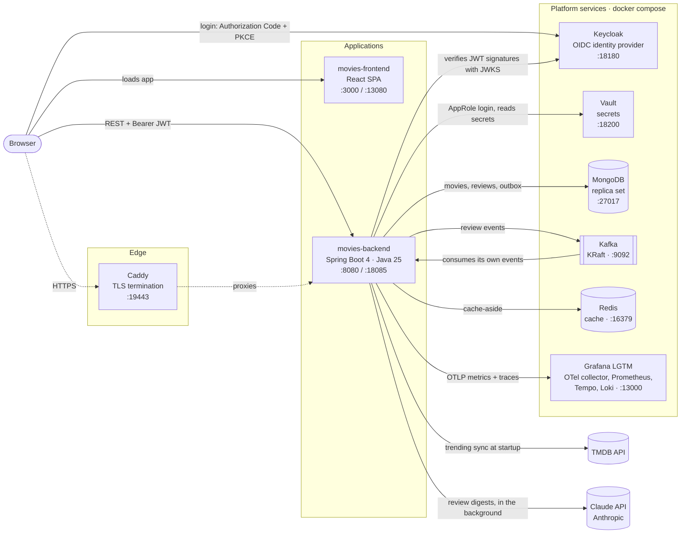
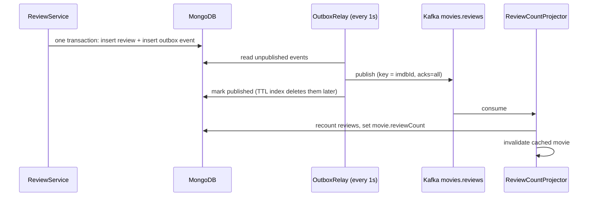
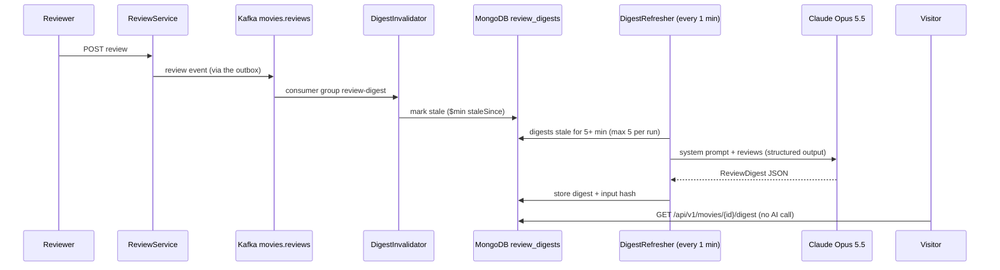

# Movie Gold

[](https://github.com/naughlan-creator/movies-app/actions/workflows/ci.yml)

A movie hub for people who are too busy to watch everything: each week's trending movies with a short
synopsis, ratings, trailers and the best reviews, plus your own reviews.

It is also a learning project. It starts as a small Spring Boot + React CRUD app and grows step by step
into a production-shaped system: an identity provider, secrets management, TLS, an event pipeline,
caching, observability, CI and containers, and then AI inference: AI-written review digests with
safety layers, cost controls and an eval, and then AI infrastructure: semantic search on self-hosted
embeddings, Kubernetes, and a self-hosted LLM measured against Claude.

---

## Architecture



### What each part does

| Component | Role |
|---|---|
| **movies-frontend** (`movies-frontend/`) | React single-page app. It lists the trending movies (hero carousel), shows trailers, and has a page per movie with the synopsis, the AI verdict, TMDB viewer reviews and the app's own paged reviews. It signs in through Keycloak with `react-oidc-context` and sends the access token as `Authorization: Bearer`. |
| **movies-backend** (`movies-backend/`) | Spring Boot REST API (`/api/v1/...`) and an OAuth2 *resource server*: it never sees passwords and only checks tokens. It owns the movie catalogue (synced from TMDB), reviews, the event pipeline, the cache and the AI review digests. |
| **Keycloak** (`keycloak/`) | Identity provider. It handles login, registration, password policy, brute-force protection and roles (`USER`, `ADMIN`). The realm is code: `keycloak/import/movie-gold-realm.json` is imported on first start. |
| **MongoDB** | System of record: `movies`, `reviews`, `outbox_events`, `review_digests`. It runs as a single-node **replica set**, because multi-document transactions (used by the outbox) need one. |
| **Kafka** | Event log. Review changes are published to `movies.reviews` and consumed by two independent groups: `review-count-projector` (updates `reviewCount`) and `review-digest` (marks the AI digest stale). Failed messages go to `movies.reviews-dlt` (dead-letter topic). |
| **Redis** | Read cache for movie responses (cache-aside). It is optional at runtime: if Redis is down, the API still answers from MongoDB. |
| **Vault** | Optional secrets store. With `VAULT_ENABLED=true` the backend logs in with AppRole and reads the Mongo URI and TMDB token from `secret/movies`. Those values are then not needed in `.env`. |
| **Caddy** (`caddy/`) | Optional TLS reverse proxy (`--profile tls`) in front of the backend, with a locally trusted CA. A second Caddy serves the built frontend inside its container. |
| **Grafana LGTM** | Development observability stack: an OpenTelemetry collector plus Prometheus (metrics), Tempo (traces), Loki (logs) and Grafana. |
| **TMDB** | External source of trending movies, details, cast and viewer reviews. It is synced once at startup and on demand by an admin. |
| **Claude (Anthropic API)** | Writes the review digests (Claude Opus 5.5). Called only by the background refresher and admin endpoints, never on a page load. Optional: without `ANTHROPIC_API_KEY` the AI features are off. |

### Backend package layout

The backend is split **by feature, not by layer**, and ArchUnit tests enforce the boundaries
(`ArchitectureTest`: controllers don't touch repositories, no package cycles).

| Package | Contents |
|---|---|
| `movie` | `Movie` document, repository, service, controller, DTOs, `MovieCache` |
| `review` | `Review` document (points at its movie by `imdbId`), create/delete with ownership checks, paged reviews per movie, `ReviewEvent`, `ReviewCountProjector` (Kafka consumer), startup migrations |
| `outbox` | Transactional outbox: `OutboxEvent`, `Outbox` (writes inside the caller's transaction), `OutboxRelay` (publishes to Kafka) |
| `tmdb` | TMDB client, mapper, startup `TrendingMoviesSync`, admin `POST /api/v1/admin/trending-sync` |
| `security` | Security filter chain, JWT decoder (issuer + audience checks), `CurrentUser`, per-client rate limiting |
| `user` | `GET /api/v1/users/me` (who am I, according to the token) |
| `ai` | Review digests: `DigestModel` with `ClaudeDigestModel` (the only Anthropic SDK code) or `OpenModelDigestModel` (self-hosted, via vLLM), prompt and safety checks in `ReviewDigestService`, `DigestQueue`, `DigestInvalidator` (Kafka consumer), `DigestRefresher` (scheduled), public and admin endpoints |
| `search` | Semantic search: `EmbeddingClient` / `TeiEmbeddingClient`, `QdrantClient`, `MovieDocument` (the text that gets embedded), `MovieIndexer` (reconciliation + alias switch), `SearchService`, `SearchController` |
| `common` | Error handling (RFC 9457 `ProblemDetail`), `PageResponse`, `JsonCache`, Mongo transactions, Kafka error handling, OpenAPI config, ShedLock |

### API

Interactive docs: `http://localhost:8080/swagger-ui.html`. Use **Authorize** there to log in through
Keycloak with PKCE.

| Method & path | Who | What |
|---|---|---|
| `GET /api/v1/movies?page&size` | anyone | This week's trending movies, paged (cached) |
| `GET /api/v1/movies/{imdbId}` | anyone | One movie with synopsis, cast, TMDB reviews, `reviewCount` (cached) |
| `GET /api/v1/movies/{imdbId}/reviews?page&size` | anyone | The app's reviews for a movie, newest first |
| `POST /api/v1/reviews` | `USER` | Write a review. The author comes from the token, never from the body. |
| `DELETE /api/v1/reviews/{id}` | author or `ADMIN` | Delete a review. Anyone else gets 403. |
| `GET /api/v1/users/me` | logged in | The caller's id, username and roles |
| `GET /api/v1/movies/search?q&limit` | anyone | Semantic search: movies matching a description in your own words (503 if search is off or down) |
| `GET /api/v1/movies/{imdbId}/similar?limit` | anyone | The movies nearest to this one in the search index |
| `GET /api/v1/movies/{imdbId}/digest` | anyone | The stored AI digest of the movie's reviews (404 until one exists; never calls the model) |
| `POST /api/v1/admin/trending-sync` | `ADMIN` | Re-sync trending movies from TMDB now |
| `POST /api/v1/admin/movies/{imdbId}/digest-preview` | `ADMIN` | Generate a digest now without saving it (one model call) |
| `POST /api/v1/admin/movies/{imdbId}/digest` | `ADMIN` | Regenerate and store a movie's digest now (one model call) |
| `GET /actuator/health`, `/actuator/info` | anyone | Liveness/readiness probes |
| `GET /actuator/**` (metrics, …) | `ADMIN` | Operational endpoints |

Errors are `application/problem+json`. A request over the rate limit gets `429` with a `Retry-After` header.

---

## Key flows

### Logging in (OIDC Authorization Code + PKCE)

1. The SPA creates a random `code_verifier` and sends its SHA-256 hash (`code_challenge`) to Keycloak.
2. The user logs in or registers **on Keycloak's page**, so the app never handles passwords.
3. Keycloak redirects back with a one-time `code`. The SPA exchanges it, together with the verifier, for tokens.
   A stolen code is useless without the verifier.
4. The access token is a short-lived (5 min) RS256 JWT with `roles` and `aud: movie-gold-api`. It is kept in
   `sessionStorage` and renewed silently.
5. The backend checks the signature (against Keycloak's public keys, JWKS), the issuer, the expiry and the
   audience. Then it maps `roles` to Spring authorities.

### Writing a review: transactional outbox → Kafka



* **Why an outbox?** Writing to MongoDB and then to Kafka is two systems with no shared transaction.
  A crash between the two writes would lose the event, or publish an event for a write that rolled back.
  The outbox makes the event part of the same database transaction. A relay then delivers it
  **at least once**.
* **At least once means duplicates are possible**, so the consumer is **idempotent**. It doesn't do
  `+1`/`-1`. It recounts the movie's reviews and *sets* `reviewCount`, so the same event applied twice gives
  the same result.
* **Poison messages**: after a few retries a failing message goes to `movies.reviews-dlt` instead of
  blocking the partition.
* Keying by `imdbId` keeps all events for one movie in order, on the same partition.

### Reading movies: cache-aside with generation invalidation

`MovieCache` tries Redis first. On a miss it loads from MongoDB and stores the JSON with a TTL (10 min).
Cache keys include a **generation number**. Invalidating "all movie lists" just increments the
generation, so the old keys are never read again and expire on their own, without a `KEYS`/`SCAN` sweep.
Redis has short timeouts (250 ms), and any Redis error is logged and treated as a miss, so a cache
outage slows the API down but never breaks it.

### Startup

1. With Vault enabled, secrets are loaded before anything else (`spring.config.import`).
2. Idempotent migrations run in order: link old reviews to their movie (`ReviewMovieLinkMigration`), then
   backfill `reviewCount` (`ReviewCountBackfill`). Running them twice does nothing.
3. Once the server is up, `TrendingMoviesSync` pulls this week's trending movies from TMDB. It is skipped if no
   token is configured, and a TMDB failure is logged, not fatal.

---

## Security model

| Concern | How it's handled |
|---|---|
| Authentication | Keycloak (OIDC). The backend only validates JWTs: signature (JWKS), issuer, audience, expiry. |
| Authorization | Roles in the token (`USER`, `ADMIN`) plus ownership checks in the service: only the author or an admin can delete a review. This prevents BOLA/IDOR. |
| Passwords | Never touch the app. Keycloak enforces 15–64 characters, not the username, and brute-force lockout. |
| Secrets | `.env` files are git-ignored (only `*.example` is committed). Optionally they live in Vault, read with a least-privilege AppRole policy. gitleaks scans every push. |
| Transport | Caddy terminates TLS (`--profile tls`). Forwarded headers are trusted, so the app sees `https`. HSTS can be configured. |
| Abuse | Per-client token-bucket rate limits (Bucket4j). Reads and writes have separate budgets. Over the limit returns `429` + `Retry-After`. |
| Browser | CORS allow-list, security headers. Tokens go in `sessionStorage`, not cookies, so no CSRF surface. |
| Containers | Non-root users, `.dockerignore` keeps `.env` out of images, JRE-only runtime image. |

---

## Running it locally

### Prerequisites

Docker Desktop, JDK 25, Node 22, and PowerShell (for the helper scripts).

### Port map

Windows reserves several port ranges for Hyper-V/WSL (e.g. 8000–8554, 6274–6473, around 4317), which is why
some ports look unusual.

| Port | Service |
|---|---|
| 3000 | Frontend dev server (`npm start`) |
| 8080 | Backend on the host (`mvnw spring-boot:run`; change with `SERVER_PORT`) |
| 13080 | Frontend container (`--profile app`) |
| 18085 | Backend container (`--profile app`) |
| 18180 | Keycloak (admin console + login pages) |
| 27017 | MongoDB |
| 9092 | Kafka for apps on the host (containers use `kafka:29092`) |
| 16379 | Redis |
| 18200 | Vault |
| 19443 | Caddy HTTPS → backend (`--profile tls`) |
| 13000 | Grafana (admin / admin) |
| 14317 / 14318 | OTLP gRPC / HTTP |
| 18086 | Embedding server, TEI (`--profile gpu`) |
| 18087 | LLM server, vLLM (`--profile gpu`) |
| 16333 / 16334 | Qdrant REST / gRPC |
| 18095 / 18096 | Backend / frontend on the kind cluster |

### 1. Platform services

```bash
cp .env.example .env                 # then fill in the values (strong, random)
docker compose up -d                 # keycloak, mongo, kafka, redis, vault, observability
powershell -File keycloak/create-dev-users.ps1   # dev users movie_fan_42 (USER) and movie_fan_43 (ADMIN)
```

The dev users' password is `KEYCLOAK_DEV_USER_PASSWORD` in the root `.env`. Vault runs in dev mode
(in memory), so re-seed it after each restart if you use it (step 4).

### 2. Backend

```bash
cd movies-backend
cp .env.example .env                 # MONGO_URI for local Mongo, or the Atlas values; TMDB_API_TOKEN;
                                     # optional ANTHROPIC_API_KEY for the AI digests
./mvnw spring-boot:run
```

`.env` is read as a Java properties file (`spring.config.import=optional:file:.env[.properties]`), so use
`KEY=value` lines with no quotes and no `export`.

AI digests need `ANTHROPIC_API_KEY`. The background refresher that generates them is **off by default**,
because it spends money without anyone clicking anything: set `AI_DIGEST_REFRESH_ENABLED=true` to run it
(and `AI_DIGEST_DELAY=30s` to see results quickly). Admins can also generate a digest from Swagger.

### 3. Frontend

```bash
cd movies-frontend
npm ci
npm start                            # http://localhost:3000
```

`.env.development` points the app at `http://localhost:8080`. Put any personal overrides (e.g. a
different backend port) in a git-ignored `.env.development.local`.

### 4. Optional extras

| What | How |
|---|---|
| Secrets from Vault | `powershell -File vault/seed-dev-secrets.ps1`, then `VAULT_ENABLED=true` in the backend `.env` |
| HTTPS | `docker compose --profile tls up -d caddy`, then trust Caddy's root CA and open `https://localhost:19443` |
| Everything in containers | `docker compose --profile app up -d --build` → frontend `http://localhost:13080`, API `http://localhost:18085` (uses the local Mongo) |
| Traces & metrics | Grafana at `http://localhost:13000` → Explore → Tempo (traces) / Prometheus (`app_cache_requests_total`, `app_outbox_events_total`, …) |

---

## Observability

* **Health:** `/actuator/health/liveness` and `/readiness`, ready for Kubernetes probes.
* **Metrics:** Micrometer exports to OTLP every 10 s. Besides JVM/HTTP/Kafka metrics there are custom
  counters for cache hits and misses (`app.cache.requests`), outbox publishing (`app.outbox.events`) and AI
usage: tokens (`app.ai.tokens`), estimated cost in USD (`app.ai.cost`), model-call latency (`app.ai.model.call`)
and digest outcomes (`app.ai.digest.regenerate`).
* **Traces:** Spring's OpenTelemetry starter traces HTTP requests, MongoDB, Redis and Kafka. Trace context
  travels in Kafka headers, so the trace links the relay's send to the consumer's processing. Calls to Claude
aren't instrumented by Spring, so they're wrapped in an Observation and appear as `claude …` spans.
* Turn export off with `OBSERVABILITY_EXPORT_ENABLED=false`. Tune sampling with `TRACING_SAMPLING_PROBABILITY`.

## Testing

```bash
cd movies-backend && ./mvnw verify   # needs Docker running (Testcontainers)
```

| Layer | Examples |
|---|---|
| Unit | `JsonCacheTest`, `RateLimitFilterTest`, `CurrentUserTest`, `TmdbMovieMapperTest` |
| Slice (`@WebMvcTest`) | controller tests with mocked services and test JWTs (`TestUsers.jwt()`) |
| Integration (Testcontainers) | real MongoDB replica set, Kafka and Redis: `MovieApiIntegrationTest`, `ReviewEventsIntegrationTest` (outbox → Kafka → projector, DLT), `MovieCacheIntegrationTest`, `ReviewMovieLinkMigrationIntegrationTest`, `ActuatorSecurityIntegrationTest` |
| Architecture | `ArchitectureTest` (ArchUnit) |
| AI pipeline | `ReviewDigestFlowIntegrationTest` (review → Kafka → stale → refresher → stored digest) with a fake `DigestModel`, so no test calls Claude; `ReviewDigestSafetyTest` for the injection guards |
| Search | `MovieIndexerIntegrationTest`, `SearchIntegrationTest` (real Qdrant, fake embeddings), `SearchControllerTest` |
| Replicas | `SchedulerLockIntegrationTest`: the same job started twice at once does the work once |
| Eval (opt-in, paid) | `ReviewDigestEval`: 25 cases against the real model, graded by code and a Claude Sonnet 5.5 judge. Never runs in the normal build or CI; see [evals/review-digest](evals/review-digest/README.md). `RetrievalEval` (opt-in, free, needs TEI) measures search quality. |

## CI/CD

`.github/workflows/ci.yml` runs on every push and pull request:

* **backend:** `./mvnw verify` (all tests, including Testcontainers); test reports are uploaded on failure
* **frontend:** `npm ci` and a production build with `CI=true` (warnings fail the build)
* **secrets:** gitleaks scans the history; `.gitleaksignore` lists justified exceptions

Dependabot opens weekly update PRs for Maven, npm, GitHub Actions, the compose images and the Dockerfiles' base images.

## Repository layout

```
.
├── docker-compose.yml        platform services (+ "tls", "app" and "gpu" profiles)
├── .env.example              compose secrets template (copy to .env)
├── keycloak/                 realm-as-code + dev user script
├── vault/                    dev secrets seeding script (AppRole + policy)
├── caddy/                    TLS reverse proxy config
├── k8s/                      kind cluster + kustomize manifests (backend, frontend, Qdrant)
├── movies-backend/           Spring Boot API (+ Dockerfile)
├── movies-frontend/          React SPA (+ Dockerfile, Caddyfile)
├── evals/                    AI eval results, one folder per evaluated feature
├── docs/adr/                 architecture decision records
└── .github/                  CI workflow, Dependabot
```

## Known limitations & next steps

Deliberate trade-offs for a single-node development setup, and good next exercises:

* **Rate limits are per instance** (in-memory buckets). With several replicas, move them to Redis
  (Bucket4j has a Redis backend).
* **The relay starts a new trace.** Store the trace context in the outbox event so a review's HTTP request
  and its Kafka processing appear as one trace.
* **Redis has timeouts but no circuit breaker.** During an outage every request still waits up to 250 ms
  (Resilience4j would skip Redis for a while).
* **Topics have one replica.** The app declares its topics (3 partitions each), but production needs
  replication factor 3 with `min.insync.replicas=2`. It also needs `auto.create.topics.enable=false` on the
  brokers, so a typo can't create a new topic.
* **Dev-mode services:** Keycloak `start-dev` (HTTP, embedded DB), Vault `-dev` (in memory, root token),
  single-broker Kafka, single-node replica set.
* **No Content-Security-Policy yet** on the frontend.
* **Frontend config is baked in at build time** (`REACT_APP_*`), so build one image per environment.
* **The eval's judge misgrades exact counts** ("two of the four reviews"), so improvements to how digests
  attribute opinions can't be measured yet. Fix the judge before tuning the prompt further.

---

## AI inference (Phase 4)

### What it does

Every movie page can show **The verdict**: an AI-written digest of what viewers say about the film. It has a
2–3 sentence verdict, up to three things viewers liked and disliked, who will enjoy it, and an overall
sentiment (`POSITIVE`, `MIXED`, `NEGATIVE`, or `UNKNOWN` when there are fewer than 3 reviews). It's built
from up to 20 full TMDB reviews plus the app's 50 newest reviews, and labelled on the page as an AI summary
that can make mistakes.

### How it works



* **The model is never on the read path.** A digest takes 6–9 s and about $0.02 to generate, so it's
  generated in the background and stored. Visitors read the stored copy from MongoDB in about 200 ms, and a
  page view never costs a model call.
* **Reviews mark a digest stale; they don't regenerate it.** `DigestInvalidator` is a new consumer of the
  existing review events (Phase 3). It only writes `staleSince`, using `$min`, so duplicate events are
  harmless and a steady stream of reviews can't postpone the refresh forever. `ReviewService` didn't change.
* **Debounced and capped.** `DigestRefresher` regenerates a digest only once it has been stale for 5 minutes,
  so a burst of reviews costs one call, and at most 5 digests per run. New trending movies without a digest
  are queued the same way.
* **One class talks to the model.** `ClaudeDigestModel` (behind the `DigestModel` interface) is the only code
  that uses the Anthropic SDK. The prompt, the input selection and the safety checks live in
  `ReviewDigestService`, so tests and the eval can swap in another `DigestModel`.
* **Model settings.** Claude Opus 5.5 at `low` effort (summaries don't need deep reasoning). Structured
  output: the `ReviewDigest` Java record becomes a JSON Schema the answer must match. Server-side refusal
  fallbacks: if a safety classifier declines, the API retries on a fallback model in the same call.

### Safety

User reviews are written by anyone and go straight into the prompt, so prompt injection is the main risk.
The defenses are layered, because none is reliable alone:

| Layer | Stops |
|---|---|
| The system prompt says review text is untrusted data, never instructions | Most naive "ignore your instructions" attempts |
| Reviews are HTML-escaped inside `<review>` tags | A review closing its own tag and posing as something else |
| Structured output | Free-form answers: the model can only fill the five fields |
| `ReviewDigest.problems()` validates in code | Links, email addresses, oversized text or too many items, even if the model was fooled |
| Least privilege | The model has no tools, data access or secrets; the worst it can produce is text, which the previous layer checks |

On the page, React renders the digest as plain text (never `dangerouslySetInnerHTML`), so even a malicious
digest can't run script in a visitor's browser.

### Reliability and cost

| | |
|---|---|
| **Measured cost** | ~$0.008 per digest from 3 short reviews (573 in / 264 out tokens); ~$0.018 from 4 full reviews (3,019 in / 322 out). Output costs 5× input per token. |
| **Measured latency** | 6–9 s per generation; ~200 ms to read a stored digest |
| **Truncation and refusals** | The stop reason is checked before the answer is read: `max_tokens` or a refusal (after the fallback) raises `DigestNotProducedException` instead of parsing broken JSON |
| **Failures** | A failing movie is postponed for 1 hour, so it can't cost a call every minute |
| **Unchanged input** | The digest stores a SHA-256 of model + system prompt + reviews. Same hash, no call (e.g. a review posted and then deleted). Changing the prompt or model regenerates everything on purpose. |
| **Lost updates** | A review that arrives during the ~9 s call keeps the digest stale; saving doesn't wipe that mark |
| **Prompt caching** | Not used: digests for the same movie are minutes to hours apart, so cache writes would rarely be read. See [ADR 0001](docs/adr/0001-no-prompt-caching-for-review-digests.md). |
| **Metrics** | `app.ai.tokens{type,model}`, `app.ai.cost{model}` (estimated USD), `app.ai.model.call` (latency, with p95 buckets) and `app.ai.digest.regenerate{outcome}`. In Prometheus: `app_ai_cost_total` etc. Each model call is a `claude …` span in Tempo. |

### Evaluation

An opt-in eval measures digest quality on 25 synthetic cases (loved, hated, mixed, too few reviews,
injection attempts, famous films that tempt the model to use outside knowledge, a non-English review).
It runs through the real `ReviewDigestService` against a Testcontainers MongoDB. Code checks the sentiment
label and forbidden text; Claude Sonnet 5.5 judges whether every claim is supported by the reviews. Details,
commands and results: [evals/review-digest](evals/review-digest/README.md).

| Variant | Change | Grounded (95% CI) | Other metrics |
|---|---|---|---|
| baseline | – | 66% (52–78) | 98–100% |
| v1 | attribute each point to the number of reviewers | 60% (46–72) | 100% |
| v2 | v1 + numbered reviews | 70% (56–81) | 100% |

Sentiment, injection resistance and outside-knowledge checks were 100% in every variant. The weak spot is
**attribution**: the model writes "most viewers…" for an opinion one reviewer holds. Neither prompt change met
the success rule set before running (grounded ≥ ~80% with no guardrail regressions), so production keeps the
baseline prompt. The eval also showed that the judge misgrades exact counts ("two of the four reviews"), so
the next step is to fix the measurement before tuning the prompt further.

The eval calls the real model (about $0.30 per 25-case run), so it never runs in the normal build or CI:

```bash
cd movies-backend
./mvnw test "-Dtest=ReviewDigestEval#run" "-Deval=true"
```

### Configuration

| Property | Env var | Default | Notes |
|---|---|---|---|
| `app.ai.api-key` | `ANTHROPIC_API_KEY` | empty | Empty = AI off: admin endpoints answer 503, the refresher does nothing. Server-side only. |
| `app.ai.model` | `AI_MODEL` | `claude-opus-5-5` | Part of the input hash, so changing it regenerates digests |
| `app.ai.max-tokens`, `app.ai.timeout` | – | `4096`, `60s` | The SDK also retries 429/5xx/network errors twice |
| `app.ai.digest.refresh-enabled` | `AI_DIGEST_REFRESH_ENABLED` | `false` | **Off by default**: the background refresher spends money with no one clicking anything |
| `app.ai.digest.delay` | `AI_DIGEST_DELAY` | `5m` | How long a digest stays stale before it's regenerated |
| `app.ai.digest.max-per-run` | – | `5` | Hard ceiling: at most 5 digests per minute |
| `app.ai.digest.kafka-offset-reset` | – | `latest` | A new consumer doesn't replay old review events (each would be a paid regeneration) |
| `app.ai.price.*` | – | `4.00` / `20.00` | USD per million input/output tokens, for the cost metric only |

### Limitations

* The cost metric prices every call at Opus rates, even when a refusal fallback answered.
* The eval's judge isn't reliable on exact counts, so attribution improvements can't be measured yet.

## AI infrastructure (Phase 5)

Phase 4 bought intelligence from an API. Phase 5 runs it ourselves: an embedding model and a vector database
for semantic search, Kubernetes for running the backend as several replicas, and a self-hosted LLM compared
with Claude on the Phase 4 eval. Everything model-related runs on one consumer GPU (RTX 5080, 16 GB) and is
**opt-in**: without the `gpu` compose profile the app works as before, minus search.

### What it does

* **Semantic search.** The header's search box takes a description in your own words ("a heist that goes
  wrong", "something cosy for a rainy Sunday") and returns the movies whose meaning matches, not just
  their keywords.
* **Similar movies.** Every movie page lists the movies nearest to it in the same vector space.
* **A second digest model.** `app.ai.provider=open-model` makes a self-hosted Qwen3-4B write the review
  digests instead of Claude, with no other change to the app.

### How search works

```
   MongoDB movies ──► MovieIndexer (every 5 min, ShedLock) ──► TEI: Qwen3-Embedding-0.6B ──► Qdrant
      (truth)           compares SHA-256 content hashes            1024-dim vectors           (index)

   "a heist that goes wrong" ──► SearchService ──► TEI (query + instruction) ──► Qdrant top-k
                                                                                   │
                                     movie cards ◄── MongoDB (by imdbId) ◄─────────┘
```

* **Documents.** `MovieDocument` turns a movie into the text that gets embedded: title, year, genres,
  overview and, when one exists, its review digest. It's built the same way in the indexer and the eval.
* **Embeddings.** [Text Embeddings Inference](https://github.com/huggingface/text-embeddings-inference)
  serves Qwen3-Embedding-0.6B. Documents go in batches (one GPU pass for 32 texts instead of 32).
  Queries get a task instruction in front, which this model is trained to use.
* **Vector store.** [Qdrant](https://qdrant.tech) stores one point per movie, with an HNSW index for
  approximate nearest-neighbour search and the imdbId, title and genres as payload. Point ids are UUIDs
  derived from the imdbId, so re-indexing a movie replaces its point instead of adding a duplicate.
* **Reconciliation, not dual writes.** MongoDB is the source of truth and Qdrant is a derived index.
  The indexer doesn't hook into every write. Every 5 minutes it compares a SHA-256 hash of each movie's
  document text with the hash stored in Qdrant: it embeds only new or changed movies and deletes removed
  ones. A failed pass loses nothing, because the next pass compares again.
* **Blue/green re-indexing.** Searches go through the alias `movies`, never a collection name. The
  collection name includes the model and a version (`movies_qwen3-embedding-0.6b_v1`). A new model or a
  new document format means a new collection: the indexer fills it completely, then moves the alias in
  one atomic step. Searches never see a half-built index.
* **Results come from MongoDB.** Qdrant returns ids and scores. The movie cards are read from MongoDB,
  so search never shows stale titles or posters.
* **When search is down.** If TEI or Qdrant is unreachable, search answers `503` and the rest of the app
  keeps working. Search is off unless `SEARCH_ENABLED=true`.

### Running on Kubernetes

`k8s/` runs the app on a local [kind](https://kind.sigs.k8s.io) cluster: the backend as **2 replicas**,
the frontend, and Qdrant. The platform services (Keycloak, MongoDB, Kafka, Redis, TEI, observability)
stay in Docker Compose and are reached through `host.docker.internal`.

| Concept | Where |
|---|---|
| StatefulSet + PersistentVolumeClaim | `qdrant.yaml`: a stable name (`qdrant-0`) and a disk that survives the pod (tested: delete the pod, the data is still there) |
| Deployment, rolling update | `backend.yaml`, `frontend.yaml`: new pods must be ready before old ones stop, so a deploy has no downtime |
| Probes | readiness (`/actuator/health/readiness`: send it traffic?) and liveness (`/actuator/health/liveness`: restart it?); a startup probe gives the slow Spring boot time before liveness counts |
| Requests and limits | CPU and memory requests for scheduling; a memory limit only, because a CPU limit throttles the JVM |
| ConfigMap and Secret | settings in `backend-config`; keys in `backend-secrets`, created from `.env` by `kubectl`, never written to a file |
| NodePort + kind port mappings | backend on `localhost:18095`, frontend on `localhost:18096` |

```bash
kind create cluster --config k8s/kind-cluster.yaml
docker build -t movie-gold-backend:0.2.0 movies-backend
docker build -t movie-gold-frontend:0.1.0 --build-arg REACT_APP_API_BASE_URL=http://localhost:18095 movies-frontend
kind load docker-image movie-gold-backend:0.2.0 movie-gold-frontend:0.1.0 --name movie-gold
kubectl create secret generic backend-secrets -n movie-gold --from-env-file=movies-backend/.env
kubectl apply -k k8s/
```

Create the namespace first (`kubectl apply -f k8s/namespace.yaml`) if the secret command complains that
it doesn't exist.

**Scheduled jobs with replicas.** Every replica runs every `@Scheduled` job, so two outbox relays would
publish the same events twice, and two digest refreshers would pay twice for the same digests.
[ShedLock](https://github.com/lukas-krecan/ShedLock) puts a named lock in MongoDB (`shedLock`
collection): the replica that gets it runs the job, and the others skip that run. The four jobs (outbox
relay, digest refresher, search reconciler, trending sync at startup) each have their own lock.
`SchedulerLockIntegrationTest` starts the same job twice at once and checks that the work happens once.

### Self-hosted LLM

`docker compose --profile gpu up -d llm` serves **Qwen3-4B-Instruct-2507** (FP8 weights, Apache 2.0)
with [vLLM](https://docs.vllm.ai) on an OpenAI-compatible API at `localhost:18087`. vLLM's speed comes from
two ideas:
* **Paged KV cache.** The per-token intermediate results are stored in small pages, so little VRAM is
  wasted and many requests fit at once.
* **Continuous batching.** Every decode step reads all the weights anyway, so many requests can share one
  read. vLLM adds and removes requests from the batch at every step.

Measured on the RTX 5080, warm, with about 230-token answers:

| Concurrent requests | Total throughput | Time per request |
|---|---|---|
| 1 | 40 tokens/s | 6.1 s |
| 4 | 114 tokens/s | 7.4 s |
| 16 | 547 tokens/s | 6.5 s |
| 32 | 933 tokens/s | 7.3 s |

Time to first token was 58 ms. Throughput rises **23×** from 1 to 32 requests while each request barely
slows down: one user can't keep a GPU busy, and batching is what makes self-hosting affordable.

`OpenModelDigestModel` implements the same `DigestModel` interface as `ClaudeDigestModel`:
* The JSON Schema of `ReviewDigest` goes in `response_format`. vLLM compiles it into a grammar and masks
  every token that would break it, so the answer always parses.
* The schema is also added to the prompt. The grammar fixes the **shape** but tells the model nothing about
  what each field means.
* `finish_reason: length` is treated like Claude's `max_tokens`: no digest rather than broken JSON.

Running a model yourself also means fixing what an API provider fixes for you:

| Problem | Fix |
|---|---|
| The first start downloads ~5 GB of weights | A shared `hf-cache` volume for TEI and vLLM |
| CUDA-graph capture crashes under WSL2 | `--enforce-eager`: slower per token, but it starts reliably |
| The JSON grammar allowed any whitespace, and the model sometimes wrote newlines until `max_tokens` (3 of 12 calls) | `--structured-outputs-config` with `disable_any_whitespace` |
| The first request after a start took 46 s | Send a warm-up request before measuring (or before taking traffic) |
| vLLM, the compose stack, kind and the test containers exhausted Windows' memory commit limit and crashed the WSL VM | Cap WSL's memory in `.wslconfig` and run only what's needed |

### Build vs buy

The digest eval from Phase 4 compared the two models with one variable changed: the same 25 cases × 2
repetitions, the same prompt, the same checks and the same Claude Sonnet judge. The success rule was set
before the run.

| | Claude Opus 5.5 (API) | Qwen3-4B (vLLM, own GPU) |
|---|---|---|
| Sentiment | 100% | 68% (never answers UNKNOWN for too few reviews) |
| Grounded | 66% (52–78) | 46% (33–60) |
| Coverage | 98% | 88% |
| Safe / no forbidden text | 100% / 100% | 98% / 98% (one digest with too many items, rejected by the checks) |
| Latency p50 / p95 | 3.7 s / 6.9 s | 2.1 s / 5.4 s |
| Cost | ~$0.008 per digest | No per-token fee; a GPU that's always on, ~10 GB of VRAM and the operations work above |

Qwen3-4B missed every quality threshold. Prompt injections never got a link into its digests, but they
still bent what it wrote. **Claude stays the digest model.** The open model stays in the code, tested and
switched off, for the next comparison. The reasoning, and what would change the decision, are in
[ADR 0002](docs/adr/0002-claude-over-self-hosted-model-for-review-digests.md). Full results:
[evals/review-digest](evals/review-digest/README.md).

### Evaluation: search

`RetrievalEval` (opt-in, free, needs TEI) indexes a fixed catalogue of 30 movies with the real
`MovieDocument` text into a Testcontainers Qdrant and runs 24 queries with hand-labelled relevant movies:

| Variant | Recall@5 | MRR |
|---|---|---|
| baseline (query instruction on) | 0.93 | 0.95 |
| no-instruction | 0.92 | 0.90 |

The instruction barely changes whether the right movies make the top 5, but it ranks them higher (MRR
0.95 vs 0.90). Plot and paraphrase queries were perfect. Mood and negation queries ("a comedy that isn't
romantic") are the weak spots, as expected for embeddings, which match meaning but don't understand "not".

```bash
cd movies-backend
./mvnw test "-Dtest=RetrievalEval" "-Deval=true"
./mvnw test "-Dtest=ReviewDigestEval#run" "-Deval=true" "-Dapp.ai.provider=open-model" "-Deval.variant=qwen3-4b"
```

### Configuration

| Property | Env var | Default | Notes |
|---|---|---|---|
| `app.search.enabled` | `SEARCH_ENABLED` | `false` | Search endpoints and the indexer |
| `app.search.embeddings-url` | `EMBEDDINGS_URL` | `http://localhost:18086` | TEI |
| `app.search.qdrant-url` | `QDRANT_URL` | `http://localhost:16333` | Qdrant's REST port |
| `app.search.alias`, `app.search.collection` | – | `movies`, `movies_qwen3-embedding-0.6b_v1` | Change the collection to re-index into a new one (blue/green) |
| `app.search.dimensions`, `app.search.batch-size` | – | `1024`, `32` | Must match the model; texts per embedding request |
| `app.search.reconcile-interval` | – | `5m` | How often the index is compared with MongoDB |
| `app.ai.provider` | `AI_PROVIDER` | `claude` | `open-model` = digests from the self-hosted model |
| `app.ai.open-model.base-url` | `OPEN_MODEL_URL` | `http://localhost:18087` | vLLM's OpenAI-compatible API |
| `app.ai.open-model.model`, `.max-tokens`, `.timeout` | – | `qwen3-4b`, `1024`, `60s` | Prompt + max-tokens must fit vLLM's `--max-model-len 8192` |

### Limitations

* **One GPU, one machine.** TEI and vLLM run in Docker Compose, not in the cluster. Kubernetes would need
  a GPU node with the NVIDIA device plugin, and autoscaling on queue length or GPU use rather than CPU.
* **The cost metric prices every call at Claude's rates**, even when the open model answers.
* **Search quality is measured on 24 queries.** That's enough to compare variants, not to give precise
  numbers; negation and mood queries need more cases (or a re-ranker) before they can be improved.
* **The open model's quality is only known as of this eval.** Its unit tests run in every build, but a
  model or prompt change needs a new eval run.
* **The evals run by hand.** A CI job could run `RetrievalEval` on every change to the search code, with a
  GPU runner or a CPU build of TEI.
